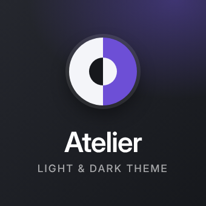
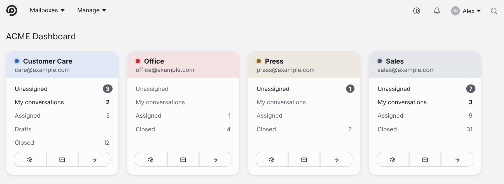
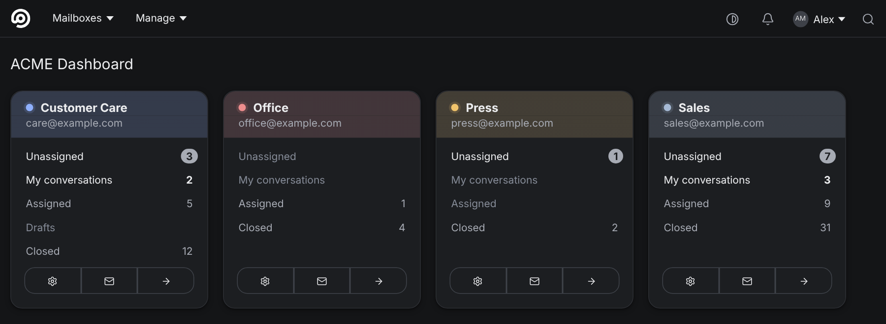
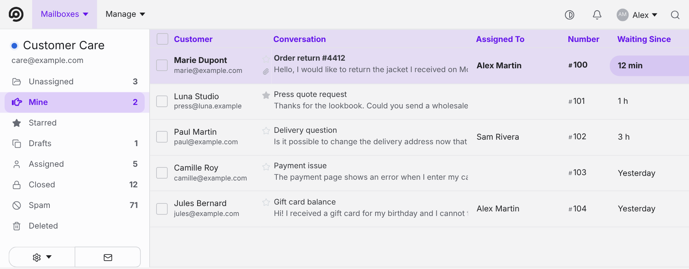
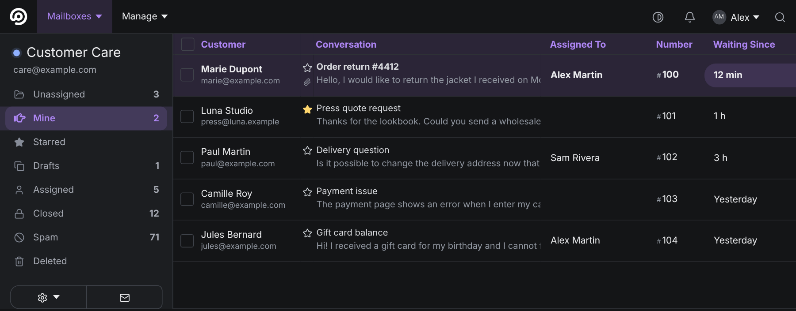
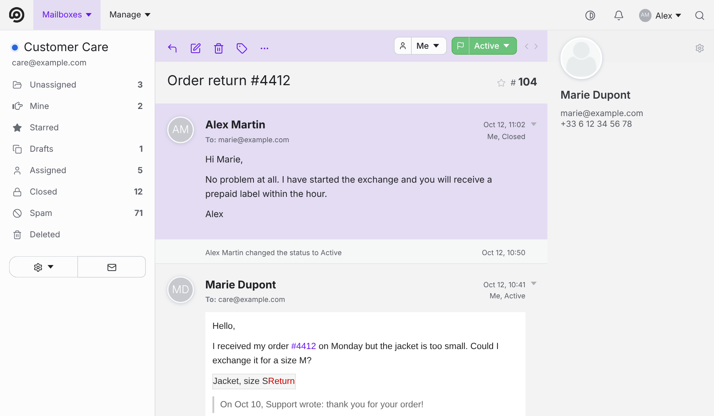
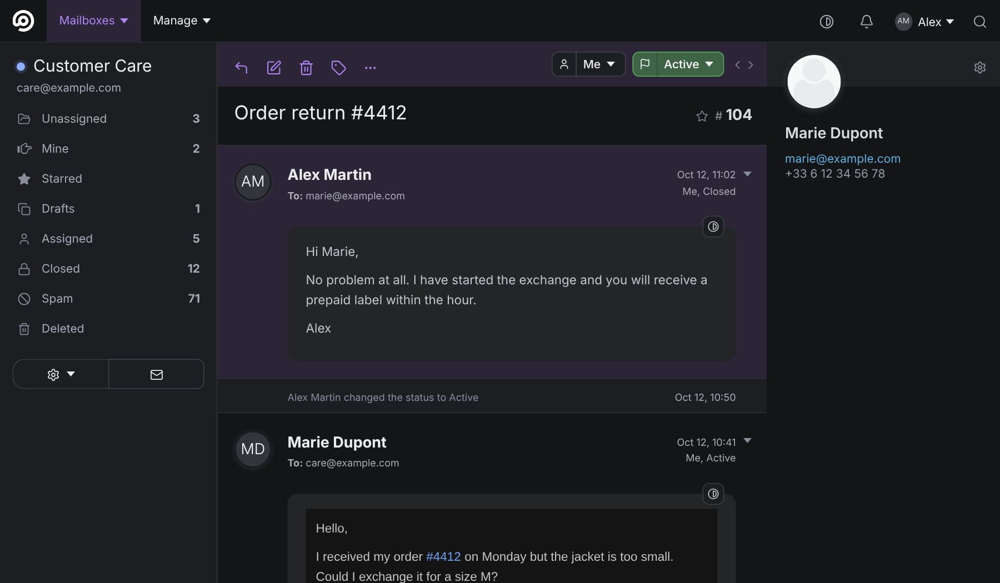
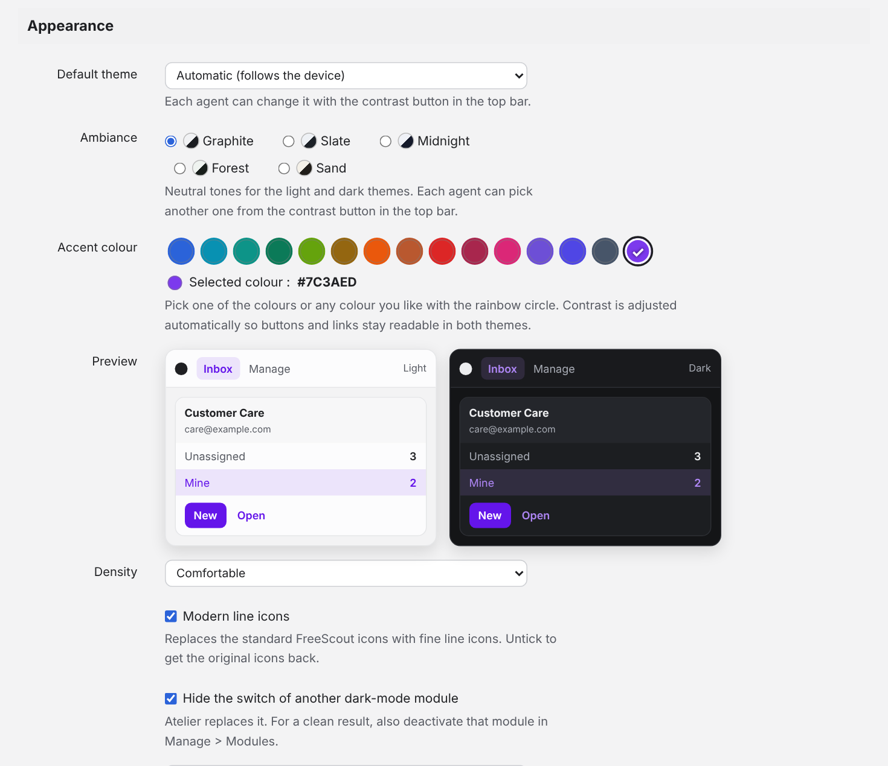
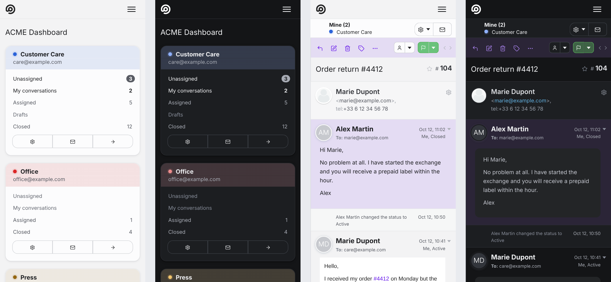

<p align="center">
  
</p>

<h1 align="center">Atelier</h1>
<p align="center">A modern light &amp; dark theme for <a href="https://freescout.net">FreeScout</a>.</p>

<p align="center">
  
  
</p>

## Features

- **Light and dark themes**, automatic (follows the device) or chosen by each agent with the contrast button in the top bar.
- **Five neutral ambiances** (Graphite, Slate, Midnight, Forest, Sand), selectable per agent.
- **Any accent colour**: a curated palette or any colour you like. Contrast is adjusted automatically so buttons and links stay readable in both themes.
- **Per-mailbox accent colours** (optional), with a switch to keep the global accent inside mailboxes if you prefer.
- **Fine line icons** replacing the stock glyphs (optional).
- **Readable e-mails in dark mode**, with the original rendering one click away.
- **Sender logos as avatars** for customers without a photo (optional; the server fetches each logo once and sends only the domain name).
- **Light and dark logos**, live preview, import / export of the settings.
- **Responsive**: designed for desktop and phone.
- **Built-in updater** (Settings > Atelier), with automatic backup and rollback.
- Interface available in English, French, Spanish, German and Italian.

<p align="center">
  
  
  
  
</p>

## Requirements

FreeScout 1.8.0 or newer. Atelier only changes the look: it adds no database table and does not touch FreeScout's files.

## Install

1. Download `Atelier.zip` from the [latest release](https://github.com/haugtolas/freescout-atelier/releases/latest).
2. Unzip it and copy the `Atelier` folder into FreeScout's `Modules/` directory, so you get `Modules/Atelier/module.json`.
3. In FreeScout, open **Manage > Modules** and click **Activate** under Atelier.
4. Open **Manage > Settings > Atelier** to choose your colours.

If you use another dark-mode module, deactivate it for a clean result (Atelier can also hide its switch).

## Update

Atelier is updated like any other third-party FreeScout module:

- **Manage > Modules**: when a new release is published, an **Update** button appears under Atelier. One click, no download.
- **Manage > Settings > Atelier > Updates**: check for a new version and install it. A backup of the current version is made first, and you can roll back from the same screen.

The first installation is always manual (steps above); every later version can be installed from inside FreeScout.

## Settings

<p align="center"></p>

## Mobile

<p align="center"></p>

## Troubleshooting

- **The interface looks broken after an update**: clear the cache (`php artisan freescout:clear-cache`) and reload with a hard refresh.
- **Emergency switch**: create an empty file `storage/app/atelier.disabled`. Atelier then stops injecting anything and FreeScout looks stock again. Delete the file to turn it back on.
- **Uninstall**: deactivate the module in Manage > Modules, then delete `Modules/Atelier`.

## Development

The stylesheet is built from layers in `dev/src`:

```sh
python3 dev/assemble.py     # rebuilds Atelier/Public/css/atelier.css
```

Releases are built by GitHub Actions: pushing a tag such as `v1.5.1` (matching `version` in `Atelier/module.json`) publishes `Atelier.zip`, whose root folder is `Atelier/`, as required by FreeScout's module updater. See [CONTRIBUTING.md](CONTRIBUTING.md).

## Licence

[AGPL-3.0](LICENSE), like FreeScout. Icons are derived from [Lucide](https://lucide.dev) (ISC), see [NOTICE](NOTICE).

Atelier is an independent project and is not affiliated with or endorsed by FreeScout.
